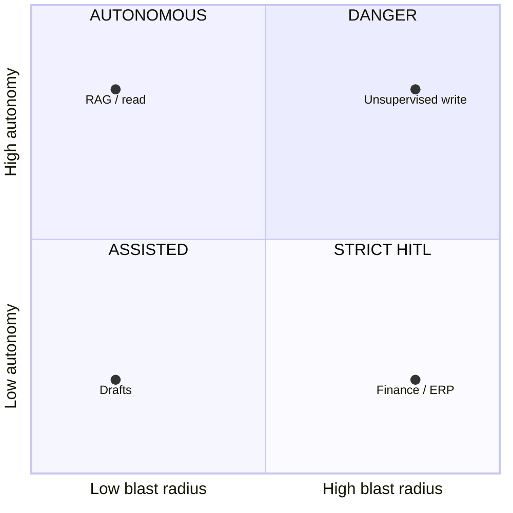

# Blast Radius vs. Agent Autonomy {#blast-radius-matrix}

The right model is a **2×2 quadrant matrix**: it shows which operations can run autonomously, which need human review, and which are prohibited.

- Horizontal axis: blast radius, from low impact to high impact.
- Vertical axis: agent autonomy, from supervised to autonomous.
- The high-impact, high-autonomy quadrant is the danger zone.

@answer scope="Qualitative governance zones from the supplied specification; positions are illustrative, not scored thresholds."
@meta locale=en

## Governance matrix {#governance-matrix}

## What belongs in each quadrant? {#quadrant-controls}

| Zone | Examples | Required control |
| --- | --- | --- |
| Autonomous | RAG / FAQ, DW reads, intent classification | Allow autonomous read-only work. |
| Danger | Direct ERP mutation, data deletion without HITL | Prohibit autonomous high-impact mutation. |
| Assisted | Internal drafts, vector research, business analysis | Keep the user in control before use. |
| Strict HITL | Financial transfers, stock movement, bulk email, sensitive record changes | Dry-run, durable approval, and an audited human decision. |

@callout id=threshold-note level=note title="How to read the positions"
The points communicate relative policy zones from the supplied matrix. They are not calibrated risk scores; define numeric thresholds separately if the policy needs them.
