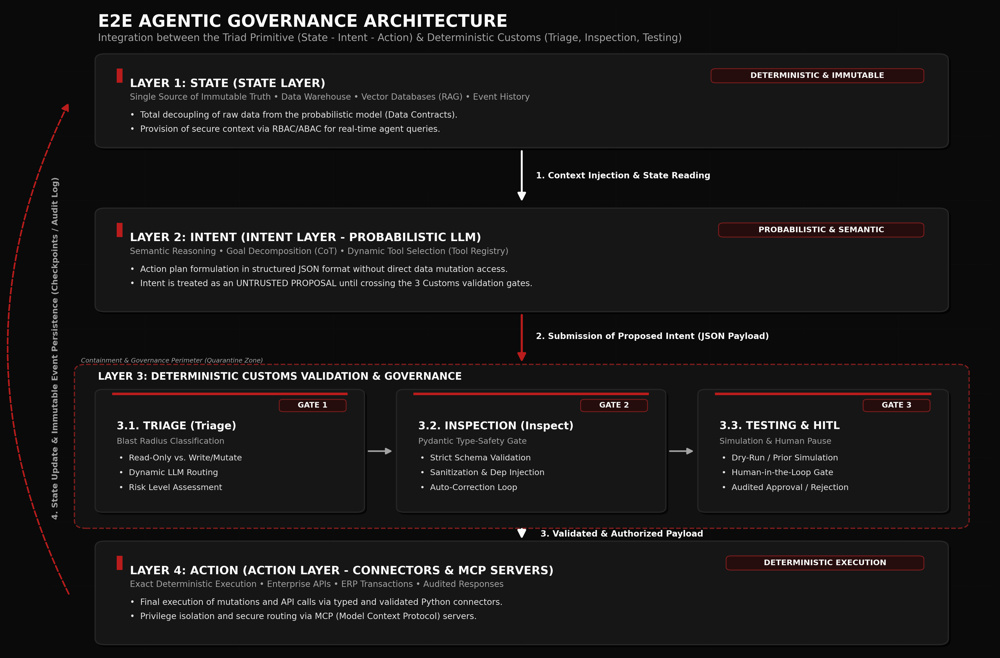
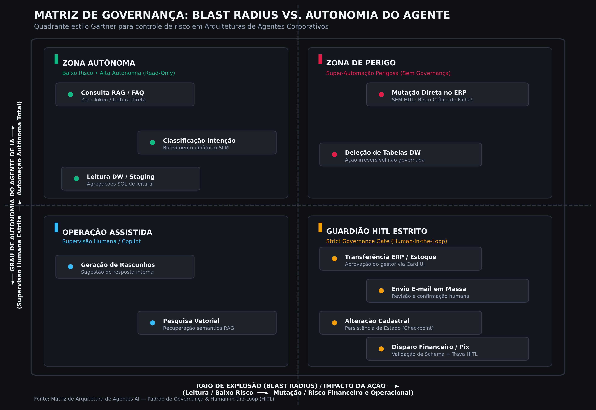

# Agentic E2E Governance

**A reference architecture and Python skeleton for keeping AI-generated proposals separate from real-world execution.**

This project explores how organizations can use language models for flexible reasoning without giving them direct authority to mutate business systems. The model proposes an action; deterministic software validates, classifies, and authorizes it; typed connectors perform any approved operation; and the outcome is recorded for audit and future state.

> **Status:** This repository is an early reference implementation. The Python pipeline uses in-memory adapters and is not production-ready. The enterprise services described in the specification are target integrations, not services shipped here.

## Why this project exists

An LLM can produce a plausible but invalid or unsafe instruction. If it can directly write to a database, call a payment API, or change an ERP record, a model error can become a business incident.

Agentic E2E Governance applies a deterministic control boundary between probabilistic reasoning and execution:

- The LLM has no direct write path to business data or external systems.
- Every model-generated intent is treated as an **untrusted proposal**.
- Typed validation, risk classification, simulation, and human approval happen before controlled mutations.
- Execution and its result are correlated with trace and audit records.

The goal is not to make model output infallible. It is to make the system reject, pause, or safely handle proposals that have not passed the required controls.

## Operating model



1. **State** provides factual context from approved data sources.
2. **Intent** uses that context to create a structured proposal. The proposal is not an instruction to execute.
3. **Deterministic Customs** applies three sequential gates:
   - **Triage** classifies read versus mutate and assesses blast radius.
   - **Inspect** validates the schema and sanitizes parameters.
   - **Test + HITL** dry-runs the operation and pauses for human approval when required.
4. **Action** uses typed connectors or MCP tools to perform only validated and authorized work.
5. **State and audit feedback** record the outcome so later requests can use the updated source of truth.

The dashed return path is a controlled update and audit loop. It is not a direct write channel from the LLM.

## Risk and autonomy policy

The project uses **blast radius** (potential impact) and **agent autonomy** (how independently an agent can act) to describe four operating zones:



| Zone | Example work | Intended control |
| --- | --- | --- |
| **Autonomous** — low impact, high autonomy | Read-only DW queries, RAG / FAQ, intent classification | Permit bounded read-only work. |
| **Assisted** — low impact, low autonomy | Drafts, vector research, analysis suggestions | Keep a person in control before the result is used. |
| **Strict HITL** — high impact, low autonomy | Financial transfers, ERP / stock changes, bulk email | Require dry-run and an audited human decision. |
| **Danger** — high impact, high autonomy | Unsupervised ERP mutation or data deletion | Prohibit autonomous execution. |

These are qualitative policy zones, not calibrated numerical scores. A deployment should define its own risk thresholds, action allowlists, approval roles, and escalation rules.

## Current Python implementation

The package provides small interfaces and in-memory adapters to demonstrate the separation of responsibilities:

- `IntentProposal` is a frozen Pydantic model that rejects unknown top-level fields.
- `TriageGate` classifies reads as low risk and requires HITL for mutations; selected high-impact action types are marked high risk.
- `InspectionGate` validates action parameters against a strict Pydantic schema.
- `DryRunGate` is an interface with an in-memory example implementation.
- `HumanGate` represents pending, approved, and rejected decisions.
- `ActionExecutor`, `StateReader`, and `StateStore` are adapter interfaces with in-memory examples.
- `GovernedPipeline` coordinates context reading, proposal generation, customs checks, action execution, and event recording.

Run the demo to see a read-only proposal execute and a high-risk mutation stop at a pending human gate.

### Important prototype limitations

This code demonstrates the control flow; it does not yet enforce a complete enterprise security boundary:

- State and audit records exist only in process memory; they are not durable or immutable.
- The intent generator is static test/demo code, not an LLM integration.
- Dry-run checks are illustrative, not connected to a sandbox or target system.
- The human gate raises a pending-approval signal, but there is no durable approval store or workflow-resume implementation yet.
- The action executor is a stub; it does not connect to an ERP, database, API, or MCP server.
- Authentication, authorization, tenant isolation, secrets handling, idempotency, retries, and production observability are not implemented.

**Do not connect this skeleton to production systems or real credentials.** Implement and review the missing controls before using it for real operations.

## Run locally

Requires Python 3.11 or newer.

```powershell
python -m venv .venv
.\.venv\Scripts\Activate.ps1
python -m pip install -e ".[dev]"
python -m pytest
python -m governance_agent.main
```

The demo uses only in-memory components. It makes no external service calls.

## Intended enterprise direction

The technology choices below describe the target architecture in [`specification.md`](specification.md); they are not installed or wired into the current Python package.

| Concern | Target role |
| --- | --- |
| Entry and channel automation | Self-hosted n8n receives requests and normalizes inputs. |
| Durable orchestration | Temporal persists workflow state and supports long-lived human approval waits. |
| Typed governance and tools | PydanticAI and MCP support schema-checked proposals and separated tool execution. |
| Model independence | LiteLLM routes to local or remote model providers such as vLLM or Ollama. |
| Data and retrieval | PostgreSQL / pgvector stores application state and retrieval data; Dagster manages data assets. |
| Audit and observability | OpenTelemetry propagates traces; ClickHouse stores audit events. |

Evaluate each component's current license, security posture, and operational requirements before selecting it for a deployment. The specification describes an intended stack, not a certification of those properties.

## Repository map

```text
governance_agent/
  actions.py       # Deterministic action-executor interface and demo adapter
  customs.py       # Triage, schema inspection, and dry-run gates
  hitl.py          # Human decision state
  intent.py        # Intent-generator interface and static demo adapter
  models.py        # Typed intent, risk, approval, and audit models
  pipeline.py      # End-to-end governance coordinator
  state.py         # State reader/store interfaces and in-memory adapters
tests/
  test_governance.py
specification.md   # Full architecture and governance rationale
```

## Project materials

- [Technical architecture specification](specification.md)
- [Element-by-element governance guide](governance-element-guide.md)
- [Explainability and traceability pillars](explainability_pillars.png)

## Next implementation milestones

1. Define action-specific schemas, permissions, risk rules, and audit requirements.
2. Add durable state, event persistence, and trace propagation.
3. Implement a durable HITL approval-and-resume workflow.
4. Add isolated dry-run environments and reviewed connectors for selected systems.
5. Integrate model routing and MCP behind explicit least-privilege policies.
6. Validate rejection, retries, duplicate requests, failures, and audit recovery before any production pilot.
